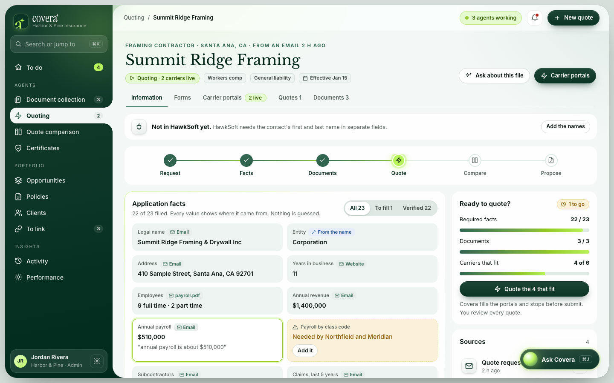
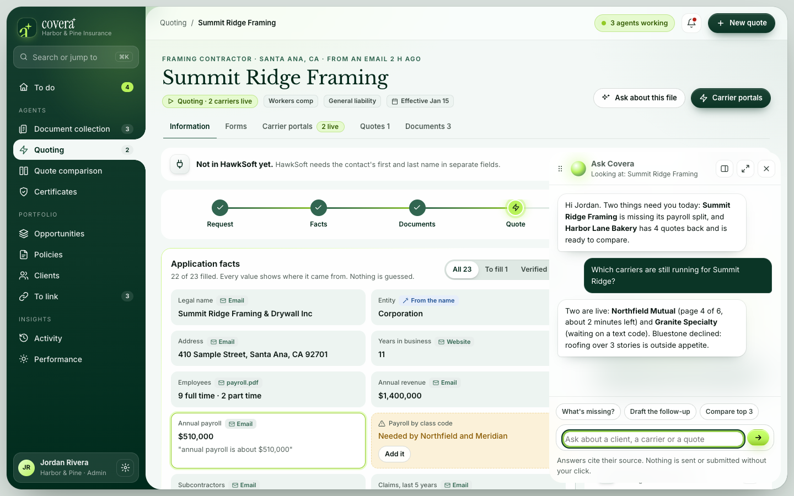
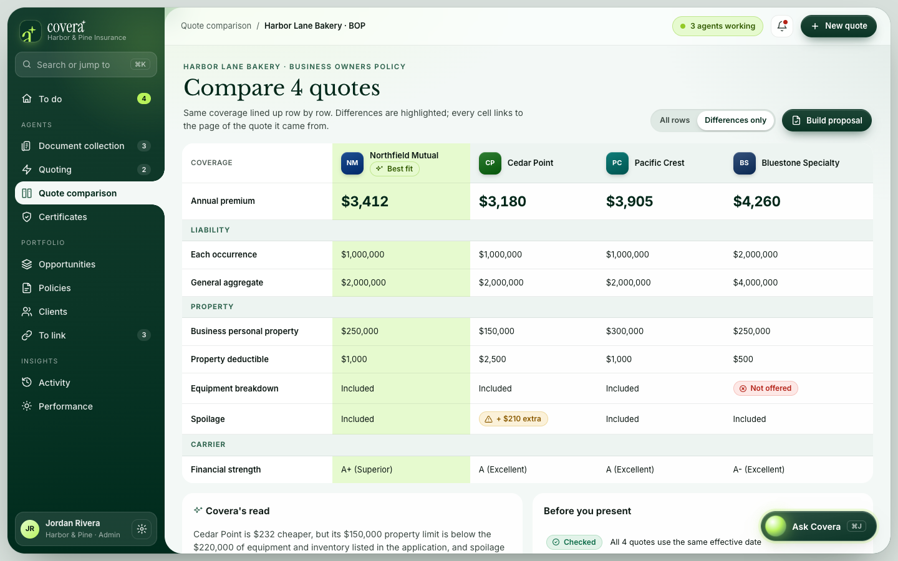
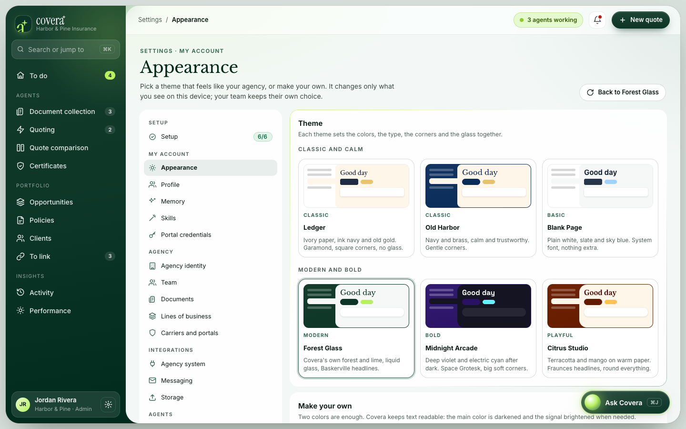
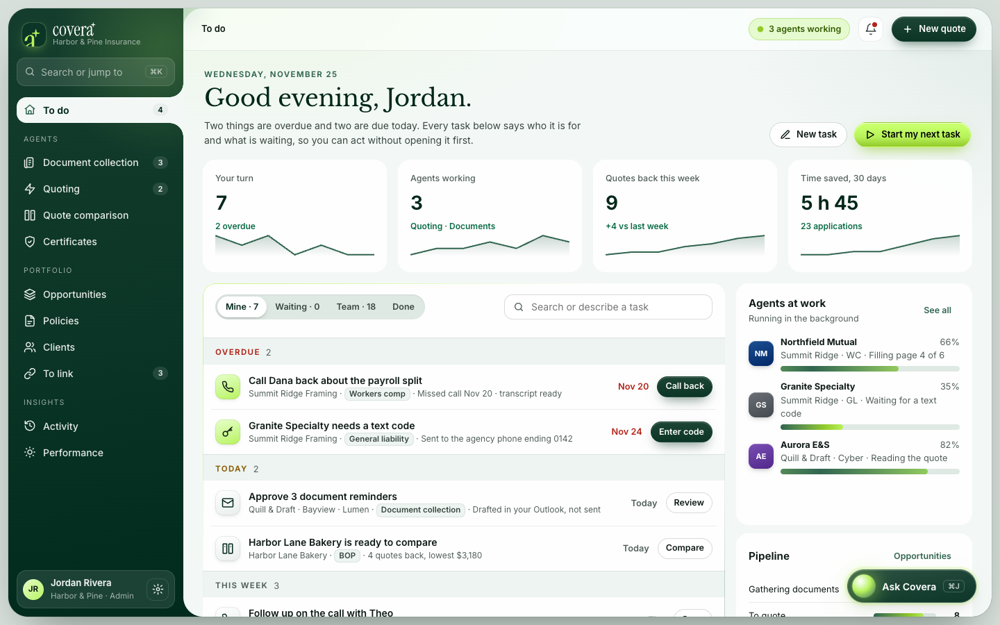

# Thank You Covera

**Live:** https://done-for-you-insurance.github.io/Thank-You-Covera/  
**Prototype:** https://done-for-you-insurance.github.io/Thank-You-Covera/app.html

A thank-you gift to the Covera team from the Done For You Insurance team: a screen-by-screen review of the Covera agent app and a working, clickable redesign.

**Start here:** open `index.html` for the note, the review of 16 screens and the design system, then `app.html` for the prototype.

## A quick look

| | |
|---|---|
|  |  |
| To do names the person and what is waiting | One opportunity, one next step, every fact sourced |
|  |  |
| One floating assistant you can drag, dock or make full screen | Quotes side by side, differences flagged |
|  |  |
| Six themes plus make your own | Midnight Arcade, one of the bold themes |

All 21 screenshots are in [`screenshots/`](screenshots/) and in the gallery on the live page.

## What is inside

| File | What it is |
|---|---|
| `index.html` | Thank-you note, six design ideas, before-and-after review of every screen, ten app-wide fixes, design system |
| `app.html` + `app.js` | The prototype: To do, Assistant, Document collection, Quoting, an opportunity, Carrier portals, Quote comparison, Proposal, Certificates, Opportunities, Policies, Clients, To link, Activity, Performance, Settings, Carriers and portals |
| `styles.css` | Design tokens, the six themes and every component (one file, plain CSS) |
| `theme.js` | Applies the saved theme before the page draws, so there is no flash |
| `assets/` | Covera's own logo files, used here only to show the concept in your brand |

Try `⌘K` (or `Ctrl+K`) for search and `⌘J` for the assistant. Every screen works at phone width.

**One floating assistant.** "Ask Covera" floats on every screen and knows which file you are on. Drag it by its grip (or focus the grip and use the arrow keys), dock it left or right from the Position menu, or make it full screen for history and starter ideas. It is a non-modal `<dialog popover>`, so the app stays usable underneath.

**Six themes** in Settings > Appearance, plus "Make your own" with two color pickers, Light / Dark / System, a light sidebar, liquid glass on or off, and compact rows:

| Theme | Feel |
|---|---|
| Ledger | Classic: ivory paper, ink navy, old gold, Garamond, square corners |
| Old Harbor | Classic: navy and brass, Baskerville, gentle corners |
| Blank Page | Basic: plain white, slate and sky blue, system font |
| Forest Glass | Modern: Covera's forest and lime with liquid glass (default) |
| Midnight Arcade | Bold: deep violet and electric cyan, dark, Space Grotesk |
| Citrus Studio | Playful: terracotta and mango on warm paper, Fraunces |

Every color derives from two tokens (`--brand`, `--signal`) with CSS relative colors and `light-dark()`, clamped so text stays readable whatever someone picks.

## Run it

No build step. Open `index.html` in a browser, or serve the folder:

```sh
python3 -m http.server 8000
```

## Design notes

- **Brand:** forest green `#0B3526` for actions, lime `#B8F25A` only as a signal (live, progress, your turn), taken from covera-agents.com.
- **Type:** Libre Baskerville for page titles, Inter for the work.
- **Liquid glass** for what floats (menu, top bar, assistant, search). Work surfaces stay near-opaque so text keeps AA contrast. Transparency and motion switch off for people who ask their system for less.
- **Status** is always an icon plus a word, never color alone.
- Built with Google Chrome's [modern-web-guidance](https://github.com/GoogleChrome/modern-web-guidance) (Apache-2.0) as the reference for the draggable panel, dialogs, dark mode, contrast and view transitions.

## Fine print

Unofficial concept. Not affiliated with or endorsed by Covera AI, Inc. The Covera name and logo belong to Covera. Every client, carrier, price and record in the prototype is invented; no data from any real account is included. Icons are adapted from [Lucide](https://lucide.dev) (ISC). Code is MIT licensed: use any of it.
